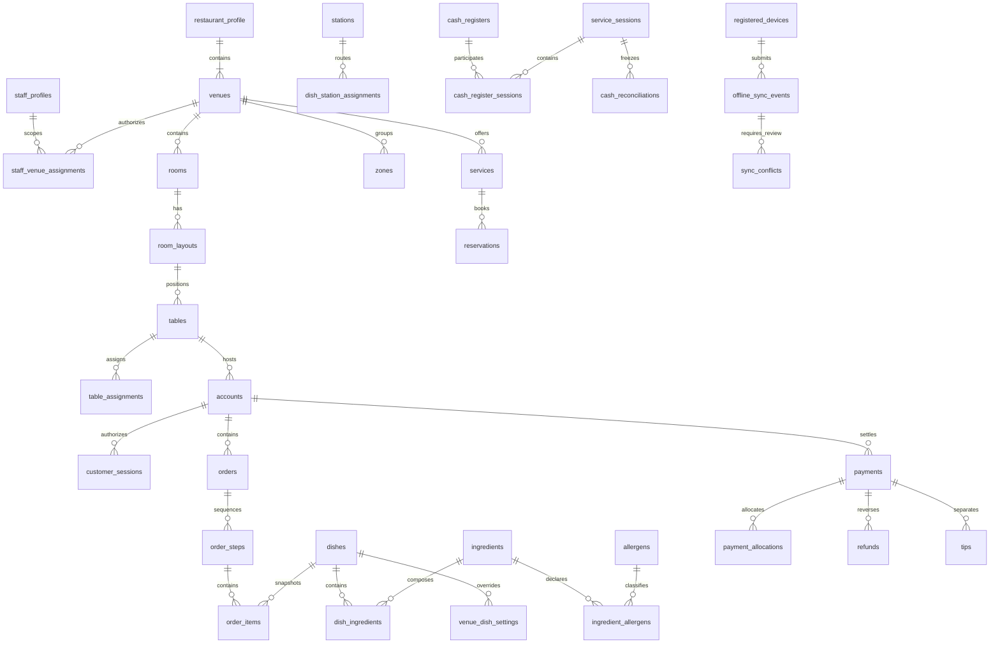

# Plateform — Architecture Blueprint

## Stato e autorità

Specifica: `MASTER_PROMPT_PLATEFORM_COMMERCIALE.md`, sezioni 0–150, conservata senza modifiche.
Questo documento descrive il progetto approvato dalla specifica, non certifica implementazione o collaudo.
Lo stato puntuale e le evidenze sono in `docs/REQUIREMENTS.json` e `docs/REVIEWS.md`.
Il repository iniziale contiene solo specifica e immagine; nessun codice preesistente.

## 1. Confini dell'architettura

Due applicazioni HTML/TypeScript vanilla con Vite: sito pubblico e PWA staff,
build e origini distinte. DOM sicuro (`textContent`, nessun HTML da dati non fidati).
Supabase fornisce Auth, PostgreSQL, Storage, Realtime, RPC e Edge Functions Deno.
Nessun backend Node applicativo. PostgreSQL calcola prezzi, disponibilità, saldi e autorizzazioni.
Le Edge Functions gestiscono segreti, provider esterni, Admin Auth API e confini HTTP.
Ogni cliente possiede un'installazione e un progetto Supabase dedicati per ambiente.
Nessuna registrazione self-service di clienti o seconda catena nello stesso database.

## 2. Chain/Venue Scope Model

`restaurant_profile`, `restaurant_settings`, `system_limits` hanno chiave singleton.
La configurazione iniziale e la prima sede vengono create nella stessa transazione.
Un lock sul singleton serializza attivazione sedi e modifica MULTI_VENUE.
Almeno una sede attiva durante ACTIVE; con MULTI_VENUE=false esattamente una.
Le entità operative hanno venue_id e foreign key composte `(venue_id, id)`:
una relazione non può collegare accidentalmente sedi diverse.
Ruoli e assegnazioni sono letti dal DB, non dai metadati modificabili del JWT.
CHAIN amplia l'ambito geografico solo per il ruolo assegnato; non conferisce altri permessi.
VENUE richiede assegnazioni esplicite e attive. Cambiare selezione in UI non autorizza nulla.
Il catalogo è condiviso, con override espliciti per prezzo, disponibilità, visibilità e stazione.

## 3. Role Permission Matrix

| Ruolo         | Letture                                               | Mutazioni                                                  | Limite                                            |
| ------------- | ----------------------------------------------------- | ---------------------------------------------------------- | ------------------------------------------------- |
| SUPER_ADMIN   | salute tecnica, configurazione, audit                 | setup, licenze, sedi, Admin, supporto, backup              | MFA obbligatoria; economia solo impersonando      |
| ADMIN         | gestione nello scope                                  | configurazione, staff non privilegiato, menu, approvazioni | VENUE non eleva scope; rischi richiedono step-up  |
| HOST          | prenotazioni, sala e tavoli                           | arrivo, assegnazione, walk-in, spostamento, unione         | nessun ordine, pagamento o menu                   |
| CASHIER       | conti, pagamenti, casse e statistiche nello scope     | split, merge, pagamento manuale, quadratura                | assegnazione cassa; rimborso/differenza con Admin |
| KITCHEN_ADMIN | stazioni e comande nella sede                         | preparazione, step autorizzati, resi                       | nessuna modifica economica                        |
| KITCHEN_STAFF | item della stazione principale/osservatrice assegnata | preparazione solo stazione principale                      | niente dati conto/prezzi                          |
| PASS          | step e comande nella sede                             | coordinamento, pronto servizio, resi                       | annullo economico approvato da Admin              |
| WAITER        | tavoli responsabili e consegne pertinenti             | conto, codice, ordine, chiamate, richieste modifica        | TABLE precede ZONE; RUNNER è modalità operativa   |
| CUSTOMER      | menu e proiezione del proprio conto                   | richiesta ordine/chiamata/conto se abilitata               | codice + sessione, mai QR da solo                 |
| SYSTEM        | job assegnato                                         | RPC private specifiche                                     | processo autenticato, nessun account umano        |

## 4. Database ERD

Technical supporting entities: immutable partitioned audit_log, telemetry_events,
notifications, print_jobs/devices, incidents/events, backup_metadata, restore_jobs,
application_releases, database_migrations_metadata. Financial snapshots are append-only.

## 5. State Machines

| Entità        | Percorso normale                                                                                                        | Eccezioni controllate                                        |
| ------------- | ----------------------------------------------------------------------------------------------------------------------- | ------------------------------------------------------------ |
| Installazione | ACTIVE ↔ SUSPENDED → PENDING_DELETION → ARCHIVED → PERMANENTLY_DELETED                                                  | backup e step-up per dismissione                             |
| Prenotazione  | REQUESTED → RESERVED → ARRIVED → SEATED → COMPLETED                                                                     | CANCELLED, NO_SHOW solo dai punti compatibili                |
| Tavolo        | AVAILABLE → RESERVED → ARRIVING → OCCUPIED → ORDERING → WAITING_SERVICE → WAITING_BILL → PAYMENT → TO_RESET → AVAILABLE | cambi coerenti con conti e sessioni                          |
| Conto         | OPEN → BILL_REQUESTED → AT_CASHIER → PARTIALLY_PAID → PAID → CLOSED                                                     | force close/reopen: Admin + password + motivo                |
| Ordine/item   | RECEIVED → IN_PREPARATION → READY → SERVED                                                                              | CANCELLED con approvazione economica; reso tracciato         |
| Step          | WAITING → ACTIVE → READY → SERVED                                                                                       | attivazione da ruoli configurati                             |
| Chiamata      | NEW → ACCEPTED → COMPLETED                                                                                              | riassegnazione auditata                                      |
| Pagamento     | PENDING → COMPLETED → PARTIALLY_REFUNDED → REFUNDED                                                                     | FAILED/CANCELLED; callback tardivi riconciliati              |
| Rimborso      | REQUESTED → APPROVED → PENDING → COMPLETED                                                                              | FAILED/REJECTED, retry idempotente                           |
| Cassa         | CLOSED ↔ OPEN                                                                                                           | indipendente dal servizio contabile                          |
| Servizio      | OPEN → RECONCILING → AWAITING_APPROVAL → CLOSED                                                                         | differenza nulla può chiudere direttamente                   |
| Stampa        | QUEUED → SENT → SUCCESS                                                                                                 | FAILED → QUEUED, CANCELLED; esito ambiguo richiede operatore |
| Backup        | QUEUED → RUNNING → SUCCEEDED                                                                                            | FAILED; mai successo per sola richiesta                      |
| Restore       | REQUESTED → CONFIRMED → SNAPSHOTTING → RESTORING → VERIFYING → SUCCEEDED                                                | FAILED e recovery documentato                                |

L'API accetta comandi di dominio, non aggiornamenti arbitrari dello stato.

## 6. RLS Matrix

Tutte le tabelle pubbliche con RLS e privilegi espliciti. Default deny.
Catalogo pubblico solo campi pubblicabili; nessuna lettura anonima di tabelle operative.
Staff scope + ruolo + assegnazione per tutte le letture. Customer solo proiezioni dedicate
senza note interne, stazioni, prezzi di costo o identità staff.
Scritture sensibili solo RPC con search_path vuoto e nomi qualificati. Helpers nello schema
private non esposto a PostgREST. REVOKE EXECUTE PUBLIC per default; grant funzione per funzione.
Storage pubblico solo branding/dishes/gallery approvati; documents privato per sede.
Sospensione nega tutte le operazioni e letture operative tranne accesso tecnico MFA.
Revoca staff/dispositivo verificata a ogni comando, anche replay offline.

## 7. Realtime Event Matrix

| Stream                          | Destinatari                                               | Recupero                       |
| ------------------------------- | --------------------------------------------------------- | ------------------------------ |
| catalogo/disponibilità          | visitatore proiezione pubblica; staff sede                | snapshot menu per sede         |
| tavoli/prenotazioni             | Host/Admin, waiter assegnato                              | snapshot sala e prenotazioni   |
| ordini/step                     | stazione pertinente, Pass, waiter, conto cliente filtrato | snapshot per ruolo             |
| conti/pagamenti/cassa           | Cashier/Admin; cliente proprio saldo                      | snapshot contabile server      |
| assegnazioni/chiamate/notifiche | destinatario specifico                                    | elenco persistente non risolto |
| conflitti/incidenti             | Admin scope / Super Admin tecnico                         | lista paginata                 |

Versioni monotone, deduplica, eventi come invalidazione. Alla riconnessione si risottoscrive,
si carica snapshot e si riconciliano eventi accodati; periodic refresh copre buchi persistenti.
Mai notifiche operative indiscriminate o dati economici nel canale tecnico.

## 8. Audit Event Catalogue

AUTH_LOGIN/FAILURE/LOGOUT, MFA_ENROLLED/CHALLENGED/RECOVERED, STAFF_CREATED/UPDATED/REVOKED,
SCOPE_CHANGED, VENUE_CREATED/ARCHIVED, FEATURE_CHANGED, INSTALLATION_STATUS_CHANGED,
MENU_CHANGED, ALLERGEN_OVERRIDE, AVAILABILITY_CHANGED, RESERVATION_CREATED/TRANSITIONED,
TABLE_ASSIGNED/MOVED/MERGED/SPLIT, ACCOUNT_CREATED/CODE_ROTATED/CLOSED/REOPENED,
CUSTOMER_SESSION_CREATED/REVOKED, ORDER_CREATED/APPROVED/REJECTED/MODIFIED/CANCELLED,
ITEM_TRANSITIONED, STEP_STARTED/READY/SERVED, CALL_CREATED/ACCEPTED/COMPLETED,
PAYMENT_CREATED/CONFIRMED/FAILED/REVERSED, REFUND_REQUESTED/APPROVED/COMPLETED/FAILED,
DISCOUNT_AUTHORIZED, CASH_OPENED/CLOSED, RECONCILIATION_CREATED/APPROVED,
PRINT_REQUESTED/SUCCESS/FAILED, IMPERSONATION_STARTED/WRITE_ENABLED/ENDED,
SYNC_ACCEPTED/CONFLICT/RESOLVED, DEVICE_REVOKED, EXPORT_REQUESTED/COMPLETED,
BACKUP_REQUESTED/SUCCEEDED/FAILED, RESTORE_STARTED/VERIFIED/FAILED, RELEASE_APPLIED,
INCIDENT_OPENED/UPDATED/RESOLVED. Ogni evento contiene contesto risorsa, identità reale,
eventuale impersonato, esito, request/correlation ID e old/new redatti quando pertinente.

## 9. Telemetry Event Catalogue

PAGE_VIEW, FEATURE_USED, UI_ERROR, RPC_LATENCY, RPC_ERROR, AUTH_FAILURE_COUNT,
REALTIME_RECONNECT, QUEUE_DEPTH, SYNC_CONFLICT_COUNT, PRINT_FAILURE_COUNT,
WEBHOOK_RETRY_COUNT, PAYMENT_FAILURE_COUNT, ACTIVE_SESSION_COUNT, WEB_VITAL.
Solo proprietà allowlist; niente query di ricerca, codici, payload cliente o credenziali.
Telemetria separata da audit. Metriche aggregate senza classifiche dipendenti.

## 10. Offline Strategy

Service worker separati per origine memorizzano asset versionati e menu pubblico.
IndexedDB staff contiene cache minima e coda per identità/dispositivo. Logout pulisce dati privati.
Authorization snapshot firmato con user/role/scope/venue/assignments/device/issued/expiry.
Chiave pubblica verifica locale, durata limitata; il server verifica nuovamente tutti i permessi.
Coda solo ordini e azioni non finanziarie esplicitamente consentite; nessun successo definitivo
prima del commit. Idempotency key stabile, payload hash, ordine causale per conto, base_version.
Revoca o scadenza impediscono nuovi comandi; letture pubbliche restano disponibili.

## 11. Conflict Resolution Matrix

| Conflitto                       | Risposta server                      | Risoluzione                                  |
| ------------------------------- | ------------------------------------ | -------------------------------------------- |
| ultima porzione consumata       | CONFLICT, nessun decremento parziale | Admin corregge carrello o annulla            |
| versione conto cambiata/chiuso  | CONFLICT con snapshot minimizzato    | nuova operazione coerente o scarto esplicito |
| staff/dispositivo revocato      | REJECTED                             | riautenticazione; mai replay automatico      |
| chiave ripetuta stesso payload  | risultato originale                  | nessuna duplicazione                         |
| chiave ripetuta payload diverso | IDEMPOTENCY_MISMATCH                 | nuova operazione deliberata                  |
| timeout dopo commit             | esito sconosciuto                    | retry stessa chiave, query esito             |
| webhook duplicato/fuori ordine  | deduplica + stato provider           | riconciliazione server                       |

## 12. Data Classification & Retention Matrix

| Dati                         | Classe       | Accesso/finalità                 | Retention tecnica proposta                                  |
| ---------------------------- | ------------ | -------------------------------- | ----------------------------------------------------------- |
| menu, sito, asset approvati  | PUBLIC       | presentazione ristorante         | finché pubblicati; storico dove referenziato                |
| sala, configurazioni, turni  | INTERNAL     | staff scope                      | archiviazione; conservazione configurabile                  |
| prenotazioni/contatti        | CONFIDENTIAL | Host/Admin scope                 | anonimizzazione dopo 180 giorni, configurabile              |
| conti/pagamenti              | CONFIDENTIAL | cassa/Admin e proiezione cliente | periodo approvato dal cliente, non cancellazione automatica |
| credenziali/PIN/codici/token | SENSITIVE    | Auth/hash/verifica               | scadenza breve; nessun log                                  |
| customer sessions            | SENSITIVE    | autorizzazione conto             | revoca alla chiusura, purge dopo 30 giorni                  |
| audit                        | CONFIDENTIAL | tecnico autorizzato              | append-only; archiviazione verificata, nessuna perdita      |
| telemetry e IP pseudonimi    | INTERNAL     | salute aggregata                 | 30 giorni, aggregati 90; configurabile                      |
| backup                       | SENSITIVE    | operatori tecnici                | 30 giorni baseline, cifrati, accessi tracciati              |

Questi valori sono impostazioni tecniche iniziali da approvare nel deployment, non basi
giuridiche. Export/correzione/anonimizzazione tracciati; audit minimizzato per evitare PII.

## 13. Observability Plan

Log JSON allowlist con ambiente/release/request/correlation/operazione/esito/latenza.
Metriche p50/p95/p99 RPC, errori DB/Auth/Edge, coda, sync, stampa, webhook e sessioni.
Soglie iniziali configurabili: DB irraggiungibile >60s CRITICAL; webhook falliti >=3/5min
INCIDENT; stampa in coda >5min WARNING; backup giornaliero mancante INCIDENT.
Probe reali e stato UNKNOWN senza evidenze. Incidenti con owner, timeline, impatto e postmortem.
Target progettuali: UI <100ms, RPC p95 <500ms, realtime <1s; da misurare su infrastruttura reale.

## 14. Environment & Deployment Plan

Development locale, staging e production isolati; chiavi e URL distinti, provider sandbox/live.
Vite produce dist/public e dist/staff con configurazione URL centralizzata.
Hosting statico HTTPS con rewrite SPA, CSP specifica per Supabase/provider, HSTS,
nosniff, Referrer-Policy e Permissions-Policy. Nessuna source map pubblicata.
Auth signup disabilitato, redirect allowlist per staff, SMTP opzionale per alias tecnici.
Nuovo cliente: progetti → domini → migrazioni → bootstrap Super Admin → MFA → setup
profilo/sede → Admin → branding/menu/sala → acceptance → release approvata.

## 15. Migration/Rollback Plan

Migrazioni numerate append-only, checksum e metadati schema separati dalla versione app.
Schema expand → backfill → codice compatibile → verify → contract differito.
Rollback applicativo tramite artefatto precedente; DB preferisce roll-forward compatibile.
Migrazione rischiosa: backup verificato, prova staging, finestra e stima lock/spazio.
Restore in progetto isolato, controllo Auth/Storage/DB/audit e riconciliazione pagamenti
prima di switch DNS. Il restore non può dichiararsi riuscito prima dei controlli.

## 16. Release Plan e gate

R1 core, R2 esperienza cliente, R3 integrazioni/offline/avanzate come §148; il goal include tutte.
Gate comuni: format, lint, strict types, unit, migration, RLS, integration, build, E2E.
Schema: rehearsal e restore. Pagamenti: sandbox, retry, duplicati, fuori ordine, concorrenza.
Sicurezza: auth/MFA/scope/sessioni/Storage e accessi diretti via API.
Production solo dopo staging, approvazione release e configurazione esterna verificata.
Tre revisioni COMPLETE consecutive senza modifiche, non tre esecuzioni della stessa suite.
Ogni problema azzera il conteggio; requisiti incompleti impediscono revisione pulita.

## 17. Threat Model

| Minaccia                       | Controlli                                           | Verifica                                            |
| ------------------------------ | --------------------------------------------------- | --------------------------------------------------- |
| IDOR tra sedi/conti            | RLS + FK composite + scope/assignment               | JWT diversi, ID alterati, REST/RPC/Realtime/Storage |
| escalation ruolo               | dati ruolo server, grant minimi, step-up            | metadati JWT non fidati, Admin VENUE                |
| bypass MFA/revoca              | aal2 server, session/device revocation              | token vecchio, aal1, replay offline                 |
| brute force QR/PIN             | CSPRNG, hash, rate limit IP/device/session, backoff | tentativi paralleli e lockout                       |
| prezzo/quantità/saldo alterato | integer cents, catalogo server, transazione, lock   | payload falsi, stock 1 con due richieste            |
| doppio incasso/rimborso        | lock conto/pagamento, allocation, chiave e hash     | due casse, timeout dopo commit                      |
| webhook falso/replay           | firma/raw body, deduplica, retrieve provider        | firma errata, duplicati, eventi fuori ordine        |
| supporto eccessivo             | impersonazione scadente read-only, step-up write    | economia tecnica negata, doppia identità audit      |
| XSS/secrets                    | textContent, CSP, URL allowlist, env server         | payload HTML, bundle secret scan                    |
| perdita dati/audit             | append-only, backup cifrati, restore rehearsal      | UPDATE/DELETE audit negati, ripristino isolato      |

## 18. UX flow per ruolo

Visitatore: home editoriale → menu/storia/gallery/contatti → prenota se abilitato.
Cliente: QR permanente → codice → menu e proprio conto → richiesta → esito → chiama.
Waiter: sala/tavoli assegnati → conto → piatti/varianti/step → invia → stato verificato.
Runner: consegne pronte → presa in carico → servito. Host: sala dominante + prenotazioni →
arrivo → suggerimento → decisione/assegnazione; nessuna promessa di riuso temporale.
Cucina: ticket grandi per stazione → prepara → pronto; osservatrici sola lettura.
Pass: step raggruppato → pronto servizio → notifica assegnata.
Cassa: ricerca → divisione → metodo/importo/mancia → conferma server → ricevuta non fiscale.
Admin: configurazione → servizio → approvazioni/notification/conflict center → statistiche.
Super Admin: MFA → salute tecnica → licenze/sedi/staff tecnico/audit → assistenza controllata.
Touch >=44px, focus/tastiera, contrasto, stati testuali, modali accessibili, feedback finito,
no successo simulato, Ctrl/Cmd+K con ricerca autorizzata, light/dark e reduced motion.

## Riferimenti tecnici verificati

- [Supabase RLS](https://supabase.com/docs/guides/database/postgres/row-level-security)
- [Database Functions](https://supabase.com/docs/guides/database/functions)
- [PGlite extensions](https://pglite.dev/extensions/): test PostgreSQL incorporato;
  non sostituisce test di Auth, Storage, Realtime o concorrenza su Supabase reale.

## Aggiornamento dello stato — 3 ottobre 2026

Il blueprint iniziale precede il codice e non è la certificazione della versione attuale.
Sono ora presenti migrazioni 1–55, due PWA, dodici Edge Functions, UI per i principali
ruoli e un servizio ausiliario Node per il bridge locale. Quest’ultimo non sostituisce
il backend Supabase: riceve solo print job autorizzati e firmati, con stato deduplicato locale.

`shared/` contiene il documento di stampa e protocollo di firma comuni a browser/server/bridge.
Cache operative e coda offline sono in `src/offline`; sorgenti server e relativi segreti
rimangono separati. Requisiti aperti, documentazione e collaudi sono tracciati nel registro;
backup/restore e dismissione protetta non hanno ancora un’implementazione completa.
