Perizia indipendente · 30 ottobre 2026

# Perizia Plateform

Versione impaginata con schermate: https://claude.ai/artifact/WdVaFAGnrKBiiTevi7isrN (privata, visibile al proprietario).

Analisi commerciale, tecnica e di design del gestionale per ristoranti Plateform, valutato come se domani dovesse essere venduto a un ristorante vero che paga, apre la sala alle 19:30 e non può permettersi un errore in cassa.

Repository ambrogiocorti/plateform-core main 0ee8b84 PR #50 4b75f1d (anteprima GitHub Pages)

Verdetto

**Oggi Plateform non è vendibile a un ristorante pagante.** Il motore è serio: un'architettura lato server ben pensata, con permessi, importi in centesimi, idempotenza e audit. Mancano però le tre cose che un ristoratore compra davvero: una cassa fiscalmente valida in Italia, la prova che il sistema regge un servizio reale, e un'interfaccia che sembri fatta da un professionista.

Il problema principale non è la quantità di funzioni, che è persino eccessiva. È che il lavoro delle ultime tre settimane è sparso in 30 pull request in bozza mai integrate, e che il front-end è stato ridisegnato cinque volte in 48 ore sovrapponendo stili invece di sostituirli. Il tuo giudizio sul sito è fondato: nelle pagine che ho fotografato ho contato **20 difetti visivi o di UX documentati**, più i segnali tipici di un'interfaccia generata da un modello.

1. Cosa ho verificato e come
2. Scheda di valutazione
3. Analisi commerciale: si può vendere?
4. Stato tecnico e processo di sviluppo
5. Report di design: perché il sito non convince
6. Registro dei difetti visivi e UX
7. La direzione di design che consiglio
8. Piano d'azione in quattro fasi
9. Resoconto dell'intervento

## 1. Cosa ho verificato e come

Ho letto la specifica (§§0–157), la roadmap, gli handoff del 12 e 17 ottobre e il codice. Poi ho eseguito i controlli del repository e ho fotografato il sito con un browser vero. Le prove riguardano due versioni:

- **`main`**, la versione ufficiale del repository;
- **PR #50**, il branch pubblicato come anteprima su GitHub Pages. È quasi certamente il «sito di adesso» che vedi tu. L'URL pubblico non è raggiungibile dal mio ambiente (il proxy lo blocca), quindi ho ricostruito lo stesso commit in locale.

Per le schermate ho usato dati di un ristorante inventato, «Osteria del Borgo», con foto segnaposto sfocate al posto delle foto vere. Senza un Supabase reale ho simulato le risposte del server, come fanno i test E2E del progetto. Le schermate del gestionale vengono dai test E2E del repository eseguiti con gli screenshot attivi.

| Controllo                      | main       | PR #50             | Nota                                                                                                                                                                                                                                                                                              |
| ------------------------------ | ---------- | ------------------ | ------------------------------------------------------------------------------------------------------------------------------------------------------------------------------------------------------------------------------------------------------------------------------------------------- |
| TypeScript (typecheck)         | pass       | pass               | Nessun errore di tipo.                                                                                                                                                                                                                                                                            |
| Lint                           | pass       | non eseguito       |                                                                                                                                                                                                                                                                                                   |
| Formattazione                  | 8 file     | non eseguito       | Solo documenti dell'handoff, incluso `CLAUDE.md`.                                                                                                                                                                                                                                                 |
| Test unitari                   | 76/76      | 133/133            |                                                                                                                                                                                                                                                                                                   |
| Test database (PGlite)         | 0 eseguiti | 169 + 4 saltati    | Su main tutti i 12 file falliscono: la migrazione `20261008163112_step11_public_rpc_permission_manifest.sql` si interrompe con `PUBLIC_RPC_SECURITY_CONTRACT_CHANGED`. Il database di main non si ricostruisce da zero; quello della PR #50 sì. Il lavoro che funziona sta nelle PR, non su main. |
| Test browser E2E               | 13/19      | 32/34              | Su main falliscono cassa, accoglienza, salute tecnica e menu pubblico. Su PR #50 falliscono la coda conti in cassa e il carrello QR.                                                                                                                                                              |
| Vulnerabilità npm (produzione) | 1 alta     | dichiarata risolta | `zod` < 4.6.6, aggiornato nella PR #50.                                                                                                                                                                                                                                                           |

**Non verificato in questa perizia:** Supabase reale, autenticazione MFA dal vivo, Realtime, pagamenti Stripe e Satispay, stampanti, tablet e telefoni veri, backup e restore. Per questi punti mi baso sui documenti del repository e lo indico come tale.

## 2. Scheda di valutazione

Voti da 1 a 10 sul grado di prontezza per la vendita, non sulla qualità dell'impegno. Sono il mio giudizio professionale, motivato riga per riga.

| Area                             | Voto | Motivo                                                                                                                                                                                                                                 |
| -------------------------------- | ---- | -------------------------------------------------------------------------------------------------------------------------------------------------------------------------------------------------------------------------------------- |
| Architettura e sicurezza di base | 7/10 | Logica autorevole sul server, RLS, idempotenza, importi interi, audit append-only, flag a prova di errore. Da verificare 10 funzioni `SECURITY DEFINER` eseguibili da utenti anonimi e 229 da utenti autenticati (advisory del 29/10). |
| Copertura funzionale             | 7/10 | Sala, comande, cucina, Pass, cassa, QR al tavolo, prenotazioni, multi-sede, offline, food cost. Più ampio di molti prodotti in commercio.                                                                                              |
| Affidabilità dimostrata          | 2/10 | Nessun servizio reale completato. Su main i test database non partono, 6 test browser su 19 falliscono.                                                                                                                                |
| Conformità fiscale Italia        | 1/10 | Solo documenti «non fiscali». Nessuna integrazione con registratore telematico né con il Sistema di Interscambio.                                                                                                                      |
| Processo di rilascio             | 2/10 | 30 pull request in bozza, main fermo, migrazioni divergenti tra main (134), branch (483–495) e staging (496).                                                                                                                          |
| Design del sito pubblico         | 3/10 | Nessun font vero, testi generici uguali per ogni cliente, layout da template SaaS, difetti visibili.                                                                                                                                   |
| UX del gestionale                | 4/10 | Flussi presenti e accessibili da tastiera, ma codici tecnici in inglese mostrati all'utente, navigazione triplicata, pianta sala poco leggibile.                                                                                       |
| Brand                            | 3/10 | Il logo è un'immagine raster generata con ChatGPT, non un marchio vettoriale utilizzabile. L'icona dell'app pesa 2,4 MB.                                                                                                               |
| Prontezza commerciale            | 2/10 | Mancano listino, contratto, SLA, onboarding guidato collaudato, supporto in orario di servizio, backup certificato.                                                                                                                    |

## 3. Analisi commerciale: si può vendere?

### 3.1 Cosa compra davvero un ristorante italiano

Un titolare non compra «un gestionale con RLS e audit append-only». Compra la certezza che stasera la cassa batte lo scontrino, le comande arrivano in cucina, il cameriere non perde un tavolo e, se qualcosa si rompe, qualcuno risponde al telefono. In ordine di priorità, un ristorante italiano cerca:

1. **Cassa conforme**: documento commerciale tramite registratore telematico, invio dei corrispettivi, fattura elettronica via SdI quando richiesta. Dal 2026 è in vigore anche l'obbligo di collegare il POS di pagamento al registratore telematico (Legge di Bilancio 2025): da confermare con un commercialista prima di definire il posizionamento.
2. **Comande veloci** dal palmare alla cucina, con stampa o schermo in cucina.
3. **Sala e conti**: tavoli, coperti, divisione del conto.
4. **Prenotazioni**, spesso già gestite con TheFork o Google: serve integrazione, non sostituzione forzata.
5. **Assistenza durante il servizio**, anche la sera e nel fine settimana.
6. Report incassi, food cost, sito e menu QR come valore aggiunto.

### 3.2 Cosa offre Plateform, distinguendo codice da prova

| Funzione                                                       | Nel codice           | Provata in servizio reale    | Vendibile oggi     |
| -------------------------------------------------------------- | -------------------- | ---------------------------- | ------------------ |
| Sala, tavoli, pianta, editor sala                              | sì                   | no                           | con pilota         |
| Comande cameriere, cucina (KDS), Pass, runner                  | sì                   | no                           | con pilota         |
| Conti, divisione, sconti, storni                               | sì                   | no                           | con pilota         |
| Scontrino / documento fiscale                                  | no                   | no                           | no                 |
| Pagamenti Stripe / Satispay                                    | branch               | no                           | no                 |
| Menu QR e ordine dal tavolo                                    | sì                   | no                           | con pilota         |
| Prenotazioni online e host                                     | sì                   | no                           | con pilota         |
| Sito pubblico del ristorante                                   | sì                   | no                           | no, da ridisegnare |
| Stampa comande Epson (print bridge)                            | sì                   | mai su hardware              | no                 |
| Offline (PWA), multi-sede                                      | sì                   | no                           | no                 |
| Food cost, menu engineering, caparre, takeaway, lista d'attesa | backend, UI parziale | no                           | no                 |
| Backup e restore                                               | sì                   | 0 backup registrati al 12/10 | no                 |

Le colonne «Pagamenti» e «Stripe/Satispay» si basano sulla PR #48, che dichiara un collaudo in sandbox su staging. Quel lavoro non è su main.

### 3.3 Il nodo fiscale cambia il prodotto

Plateform stampa correttamente la dicitura «Documento non fiscale» su conti e PDF. È onesto, ma significa che **la «Cassa» di Plateform non può sostituire il registratore telematico**. Il ristorante dovrebbe battere ogni conto due volte: in Plateform e sul registratore. Nessun titolare accetta questo flusso nel servizio serale. Bisogna scegliere una di due strade, e la scelta va fatta prima di qualunque lavoro di design sulla cassa:

#### Strada A · Cassa fiscale integrata

- Integrazione con registratori telematici certificati (driver dei produttori o RT server) o con un partner fiscale.
- Collegamento POS–RT, chiusure giornaliere, gestione resi fiscali.
- Più lavoro e responsabilità, ma prodotto completo e prezzo più alto.

#### Strada B · Gestionale di sala che affianca la cassa

- Plateform gestisce sala, comande, cucina, prenotazioni, sito.
- Il conto finale passa al sistema di cassa già presente tramite integrazione o esportazione.
- Vendita più rapida, ma va spiegata bene e serve un'integrazione con le casse più diffuse.

### 3.4 Concorrenza e posizionamento

Plateform entrerebbe in un mercato già affollato: sistemi di cassa cloud con registratore integrato, app di comanda per palmari, piattaforme di prenotazione con marketplace di clienti, POS di grandi gruppi di pagamento. Molti offrono hardware incluso, assistenza telefonica e app native. Il vantaggio dichiarato di Plateform, cioè un'installazione isolata per ogni catena con dati separati, interessa soprattutto a gruppi con più sedi e a chi tiene alla proprietà dei dati. È un argomento valido, ma non basta senza la parte fiscale e senza un pilota che dimostri tempi e affidabilità in servizio.

### 3.5 Il modello «un Supabase per cliente»: costi e manutenzione

- Ogni cliente ha il proprio progetto Supabase, che in produzione deve essere a pagamento (backup, nessuna sospensione per inattività, risorse dedicate). Il costo infrastrutturale cresce in modo lineare con i clienti.
- Ogni aggiornamento significa applicare migrazioni a N database. Con oltre 480 migrazioni e una storia già divergente tra ambienti, oggi questa operazione non è riproducibile nemmeno su uno.
- Prima del secondo cliente servono: provisioning automatico (schema, Auth, Storage, Edge Functions, segreti), aggiornamento in serie con rollback, monitoraggio centralizzato.

### 3.6 Punti di forza reali

Per correttezza vanno riconosciuti. Sono la base su cui vale la pena costruire:

- Prezzi, disponibilità, permessi e stati sono decisi dal server, non dall'interfaccia. Gli importi sono interi in centesimi e i comandi sono idempotenti.
- Il DOM viene costruito senza `innerHTML`: i nomi dei piatti con codice malevolo restano testo (provato dai test).
- Le funzioni non licenziate sono bloccate lato server, non solo nascoste.
- Attenzione reale all'accessibilità: link «Vai al contenuto», focus visibile, rispetto di `prefers-reduced-motion`, etichette sui campi.
- Onestà nei documenti: «NO-GO» dichiarato ovunque, nessuna funzione spacciata per pronta.

### 3.7 Rischi principali

| Rischio                                                                       | Impatto | Mitigazione                                                                        |
| ----------------------------------------------------------------------------- | ------- | ---------------------------------------------------------------------------------- |
| Doppio inserimento in cassa per assenza di integrazione fiscale               | alto    | Decidere tra strada A e B prima di vendere.                                        |
| Lavoro disperso in 30 PR in bozza, impossibile sapere quale sia «il prodotto» | alto    | Consolidare una sola linea su main con CI verde.                                   |
| Aggiornamenti di schema non riproducibili su più clienti                      | alto    | Baseline unica delle migrazioni e installazione da zero provata.                   |
| Perdita dati senza restore provato                                            | alto    | Backup quotidiano e prova di ripristino su progetto separato, misurando RPO e RTO. |
| Primo impatto negativo del sito e dell'interfaccia in demo                    | medio   | Design system unico, progettato da un designer, poi implementato una volta sola.   |
| Blocco del servizio senza assistenza serale                                   | medio   | Pilota con supporto presente e procedura di emergenza su carta.                    |

## 4. Stato tecnico e processo di sviluppo

### 4.1 Il repository oggi

- **main è fermo**: gli ultimi commit sono documenti di handoff e workflow di GitHub Pages. Le funzioni sviluppate dal 13 ottobre in poi vivono solo nelle PR.
- **30 pull request aperte, tutte in bozza**, alcune impilate una sull'altra (#41 → #47 → #48; #50 parte da #41). Molte risolvono lo stesso problema in modi diversi, ad esempio il recupero delle migrazioni in #8, #11, #23, #32, #33, #47 e #51.
- **Migrazioni**: 134 file su main, 483 nel branch #50, 495 nella #48, 496 sullo staging secondo la PR #51, con 14 migrazioni presenti solo su staging. La migrazione è il punto più delicato di un prodotto a installazioni multiple.
- **Documentazione sproporzionata**: su main ci sono 52 file Markdown per circa 16.000 righe, contro circa 17.800 righe di TypeScript del front-end, più 98 script di controllo. Molti documenti sono stati di avanzamento datati che si contraddicono a vicenda.

### 4.2 Controlli che danno una falsa sicurezza

Diversi «gate» del progetto verificano che certe stringhe esistano nei file, non che il prodotto funzioni. Un esempio: `scripts/check-visual-design.mjs` nella PR #50 controlla che il CSS compilato contenga nomi di classe come `.restaurant-welcome` o `--pf-blue`. Il risultato `PLATEFORM_VISUAL_ARTIFACT=PASS` significa solo che quelle classi esistono. Nella stessa build il menu ha l'immagine dei piatti spostata e tagliata (difetto D1). Un controllo visivo vero richiede screenshot confrontati e una persona che li guarda.

### 4.3 Sviluppo con più agenti AI

Dal repository emergono sessioni di Codex, ChatGPT e Claude che lavorano in parallelo su branch diversi, ognuna con i propri documenti di stato. Il risultato è tanto codice e poca integrazione. Per un prodotto da vendere serve l'opposto: una sola linea di sviluppo, una persona che decide cosa entra in main, e ogni modifica che parte dall'ultima versione integrata.

## 5. Report di design: perché il sito non convince

Diagnosi in una frase: il sito non ha un'identità. Ha sette strati di stile sovrapposti, nessun carattere tipografico vero e testi scritti per un ristorante qualunque.

### 5.1 Il sito che vedi oggi (PR #50, home desktop)

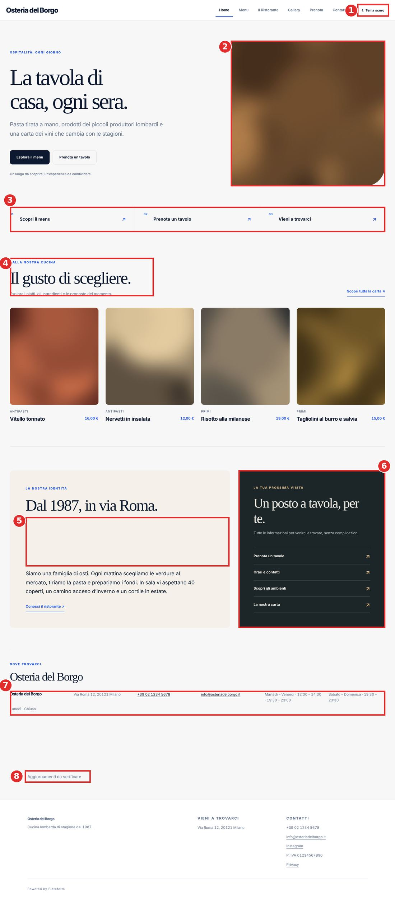

Home desktop, branch PR #50, con dati di esempio e foto segnaposto.

1. Selettore «Tema scuro» nel sito di un ristorante: occupa la posizione più preziosa dell'header e non serve al cliente.
2. Foto con un solo angolo arrotondato: un vezzo da template, senza relazione con il ristorante.
3. Riquadri numerati 01 / 02 / 03 che non sono una sequenza, con frecce ↗ che indicano un link esterno ma portano a pagine interne.
4. Testo generico scritto nel codice: «Il gusto di scegliere.» comparirà identico sul sito di ogni cliente.
5. Buco verticale tra titolo e testo nella scheda «La nostra identità».
6. Quarto punto di accesso alle stesse quattro pagine già presenti in menu, hero e riquadri.
7. Blocco «Dove trovarci» spezzato in sei colonne: gli orari vanno a capo e «Lunedì · Chiuso» resta isolato su una seconda riga.
8. «Aggiornamenti da verificare»: messaggio tecnico mostrato ai clienti quando la connessione Realtime non è attiva.

### 5.2 I segnali che «si vede che è fatto dall'AI»

#### Testi generici, uguali per ogni cliente

Il sito di un ristorante vive della voce del ristorante. Qui molte frasi sono scritte nel codice e il ristoratore non può cambiarle:

- «Il gusto di scegliere.» apps/public/main.ts:805
- «Un luogo da scoprire, un'esperienza da condividere.» apps/public/main.ts:774
- «Un posto a tavola, per te.» · «Tutte le informazioni per venirci a trovare, senza complicazioni.» apps/public/main.ts:927–928
- «Una scelta di gusto» · «Scopri la nostra cucina» · «I sapori che amiamo, preparati per essere condivisi.» apps/public/main.ts:999–1001
- «Il banco di lavoro» (titolo della cassa) src/pages/cash.ts:554
- «People. Food. Service. Together.» src/auth/staff.ts:185

Sono frasi corrette ma vuote: potrebbero stare sul sito di una pizzeria, di un sushi bar o di un hotel. È il segno più riconoscibile di un testo generato.

#### Nessun font vero

Il sito non carica alcun font. Nella PR #50 il testo usa `'Segoe UI Variable', 'Segoe UI', Arial` e i titoli `Georgia`; su main `Inter` è citato ma mai caricato. Risultato: su iPhone e Mac il sito è in **Arial e Georgia**, su Windows in Segoe UI, su Android nel font di sistema. Il brand cambia aspetto su ogni dispositivo. Il CSS chiede pesi come 750, 760, 790 e 810, che con questi font non esistono e vengono arrotondati: precisione apparente senza effetto.

#### Palette da applicazione finanziaria

Il blu elettrico usato per prezzi, link e titoletti è il colore tipico di un'app bancaria. Accanto convivono oro (login), verde petrolio (sidebar staff), avorio (scheda storia) e grigio-azzurro (sfondo menu). Nei CSS della PR #50 ci sono **102 colori esadecimali distinti**. Un sistema professionale ne usa una dozzina, tutti come token.

#### Struttura da template SaaS

Titoletto maiuscolo spaziato sopra ogni titolo, doppio bottone nell'hero, riquadri numerati, frecce diagonali, card con ombra ovunque. Sono gli schemi delle landing page di software, non quelli di un ristorante. La navigazione verso «Prenota» compare quattro volte nella sola home.

#### Stile stratificato invece che progettato

La PR #50 documenta cinque redesign in due giorni: verde e avorio, poi bianco-nero-blu, poi «UI 2», poi una riprogettazione strutturale, poi «hospitality». Ogni giro ha aggiunto file invece di sostituirli:

| Indicatore                 | main                                                                                                                                      | PR #50 |
| -------------------------- | ----------------------------------------------------------------------------------------------------------------------------------------- | ------ |
| File CSS                   | 4                                                                                                                                         | 10     |
| Righe di CSS               | ≈2.200                                                                                                                                    | 6.614  |
| Media query distinte       | 15                                                                                                                                        | 25     |
| Dichiarazioni `!important` | 11                                                                                                                                        | 24     |
| Nomi dei file              | `frontdesk-v4.css`, `restaurant-redesign.css`, `workspace-redesign.css`, `staff-app.css`, `public-app.css`, `plateform-design-system.css` |        |

Il difetto D1 qui sotto nasce proprio da due regole di due strati diversi che si contraddicono.

### 5.3 La pagina menu

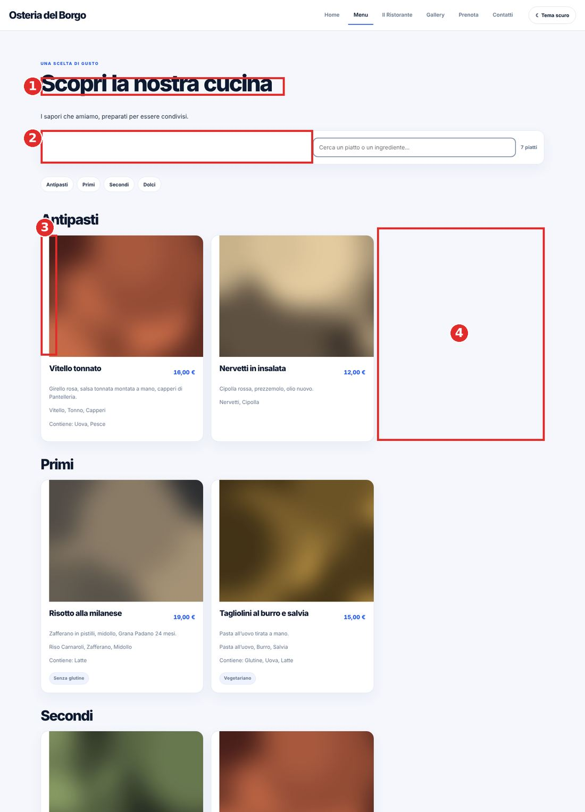

Menu desktop, PR #50.

1. Il titolo passa a un sans nero pesante mentre la home usa un serif: due linguaggi tipografici nello stesso sito.
2. Barra di ricerca con metà sinistra vuota.
3. Immagine del piatto spostata di 20 px e tagliata a destra. Causa: `.public-dish-card > :not(.public-dish-card-image)` applica il margine anche all'immagine (`styles/public-app.css`).
4. Griglia a tre colonne per categoria: con due piatti un terzo della pagina resta vuoto, in ogni categoria.
5. Sotto il menu, di nuovo il messaggio tecnico «Aggiornamenti da verificare» (fuori inquadratura).

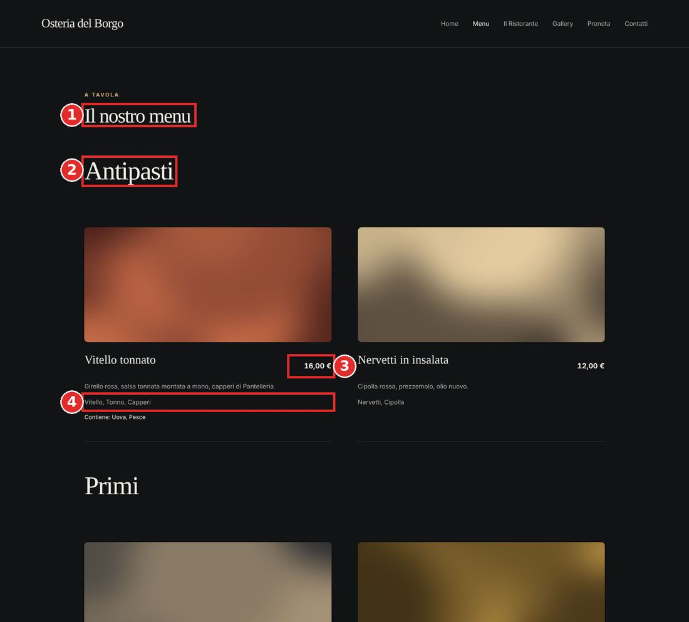

Menu desktop, main.

1. Il titolo della pagina «Il nostro menu» (42 px)…
2. …è più piccolo del titolo di categoria «Antipasti» (54 px): gerarchia invertita. Lo stesso accade nella pagina prenotazione.
3. Il prezzo non è allineato alla linea di base del nome del piatto.
4. Gli ingredienti ripetono la descrizione appena sopra.

### 5.4 Mobile e prenotazione

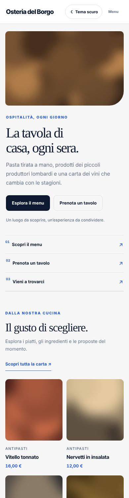

Home mobile, PR #50. L'header ospita nome, «Tema scuro» e «Menu». Il pulsante «Menu» apre la navigazione, non il menu del ristorante.

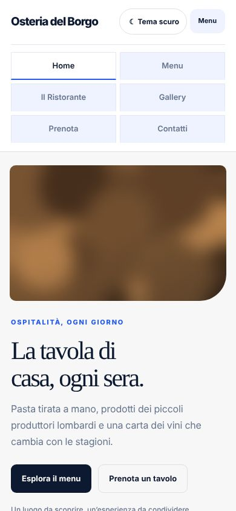

Navigazione aperta: sei bottoni azzurri a griglia, più vicini a un pannello di amministrazione che al sito di un'osteria.

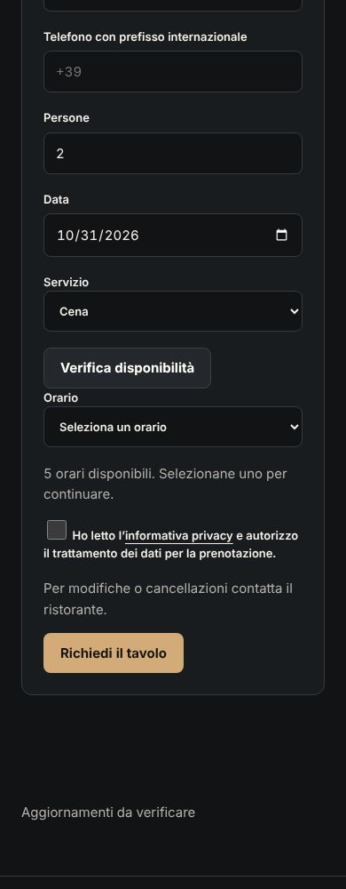

Prenotazione, main. In caso di errore il cliente legge «Verifica la connessione… Rif. 904ac488» mentre resta scritto «Verifica disponibilità in corso…». Il telefono è valido solo nel formato `+39…` senza spazi.

### 5.5 Il gestionale

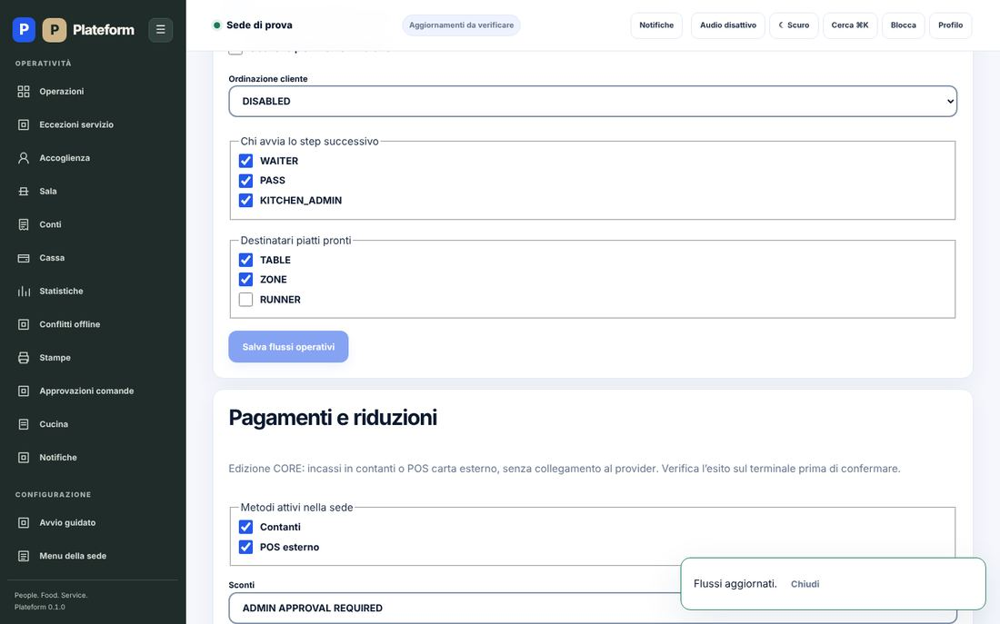

«Regole del servizio», PR #50. L'amministratore del ristorante vede codici interni del database: `DISABLED`, `WAITER`, `PASS`, `KITCHEN_ADMIN`, `TABLE`, `ZONE`, `RUNNER`, `ADMIN APPROVAL REQUIRED`. Il toast «Flussi aggiornati» copre il pulsante di salvataggio.

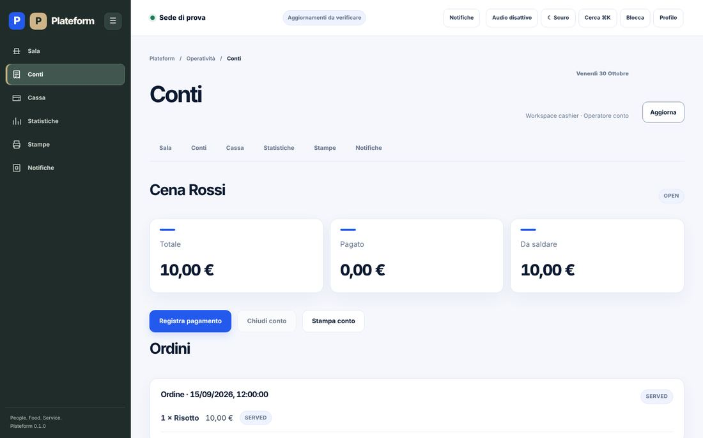

«Conti», PR #50. Tre navigazioni per la stessa cosa: sidebar, tab orizzontali e breadcrumb. Stati in inglese (`OPEN`, `SERVED`) e «Workspace cashier» in un'interfaccia italiana.

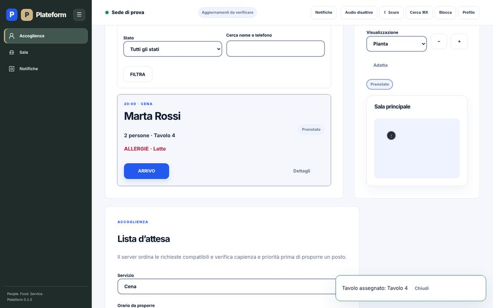

«Accoglienza», PR #50. La pianta della sala, che per la specifica deve essere dominante, è un riquadro piccolo con il tavolo ridotto a un puntino.

### 5.6 Il brand Plateform

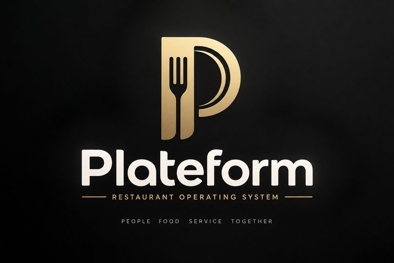

Logo originale (`assets/plateform/logo-plateform-originale.png`). Il file nasce come «ChatGPT Image 14 set 2026» e contiene i metadati C2PA di provenienza OpenAI.

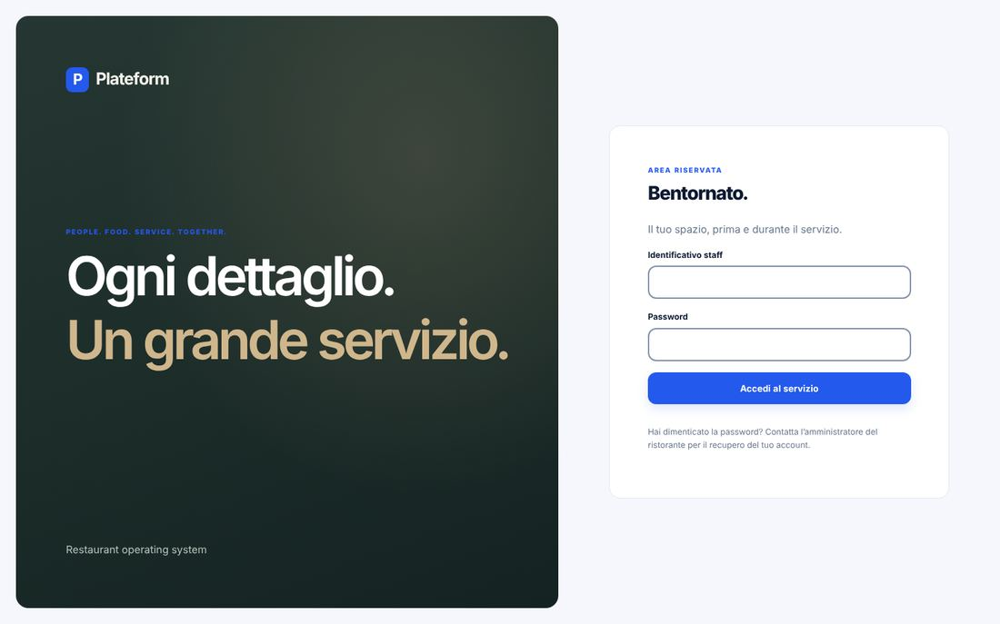

Login staff, PR #50. Al posto del logo compare una «P» bianca in un quadrato blu disegnata in CSS, in contrasto con la regola di progetto che impone il logo originale.

Il concetto del marchio è buono: la forchetta dentro la «P» è leggibile e pertinente. Il file però è il rendering di un'insegna in rilievo dorato su fondo nero texturizzato, 1536×1024 pixel, con slogan incorporati. Non è un logo utilizzabile:

- non esiste in vettoriale, né in versione monocromatica per scontrini termici e stampe;
- l'oro sfumato e il rilievo non si riproducono a 16 o 32 pixel;
- `icon.svg`, favicon e icona dell'app, pesa **2,4 MB** perché incorpora l'intero PNG, slogan compresi, ridotto in un quadrato: a dimensione favicon è illeggibile;
- lo stesso PNG da 1,8 MB è copiato tre volte nel repository (anche nella root, come «ChatGPT Image…») e due copie vengono pubblicate con il sito.

Consiglio di far ridisegnare **lo stesso marchio** in vettoriale da un designer, senza cambiare nome né concetto: versione principale, orizzontale, monogramma, nero e bianco, favicon 16/32 e icone app 192/512. La decisione resta tua, perché la regola di progetto chiede di non ricreare il brand.

**Una distinzione importante.** Plateform ha due pubblici. Il sito pubblico appartiene al ristorante e deve portare il brand del ristorante, non quello di Plateform. Il gestionale appartiene a Plateform. Oggi i due mondi si mescolano: stessi componenti, stesso blu, stessi titoletti. Il compito del sito pubblico è far sembrare bello il ristorante, poi sparire.

## 6. Registro dei difetti visivi e UX

Difetti osservati nelle schermate o confermati nel codice. Gravità riferita all'impatto su un cliente o su un operatore.

| ID  | Dove                           | Problema                                                                                                                      | Gravità |
| --- | ------------------------------ | ----------------------------------------------------------------------------------------------------------------------------- | ------- |
| D1  | Menu · PR #50                  | Immagine del piatto spostata di 20 px e tagliata (conflitto tra due regole CSS).                                              | alta    |
| D2  | Menu · PR #50                  | Griglia a tre colonne per categoria: un terzo della pagina vuoto quando una categoria ha due piatti.                          | media   |
| D3  | Menu · PR #50                  | Barra di ricerca con metà sinistra vuota.                                                                                     | bassa   |
| D4  | Home · PR #50                  | Buco verticale nella scheda «La nostra identità».                                                                             | media   |
| D5  | Home · PR #50                  | «Dove trovarci» in sei colonne: orari spezzati, giorno di chiusura isolato.                                                   | alta    |
| D6  | Tutte le pagine · entrambe     | Il cliente legge «Aggiornamenti da verificare» o «MODALITÀ OFFLINE» quando Realtime non è connesso.                           | alta    |
| D7  | Menu e Prenota · main          | Titolo di pagina più piccolo dei sottotitoli: gerarchia invertita.                                                            | media   |
| D8  | Menu · main                    | Prezzo non allineato al nome del piatto.                                                                                      | bassa   |
| D9  | Menu · entrambe                | Ingredienti ripetuti sotto la descrizione.                                                                                    | bassa   |
| D10 | Mobile · entrambe              | Il pulsante della navigazione si chiama «Menu», come la pagina del menu.                                                      | media   |
| D11 | Prenota · entrambe             | Telefono accettato solo come `+39` senza spazi; persone fino a 1000; orari in un menu a tendina dopo un pulsante di verifica. | alta    |
| D12 | Prenota · entrambe             | In caso di errore resta visibile «Verifica disponibilità in corso…» e il cliente riceve un codice di riferimento tecnico.     | media   |
| D13 | Menu · main                    | Se fallisce la sola richiesta delle «carte», l'intera pagina mostra «Il sito non è al momento disponibile».                   | alta    |
| D14 | Footer · entrambe              | Nome del ristorante a 13 px, più piccolo del testo normale.                                                                   | bassa   |
| D15 | Icona e favicon                | `icon.svg` da 2,4 MB con logo e slogan illeggibili a piccola dimensione.                                                      | media   |
| D16 | Gestionale · entrambe          | Codici interni in inglese mostrati agli utenti (`DISABLED`, `KITCHEN_ADMIN`, `OPEN`, `SERVED`, «Operational Health»).         | alta    |
| D17 | Gestionale · PR #50            | Tre sistemi di navigazione nella stessa schermata.                                                                            | media   |
| D18 | Accoglienza · entrambe         | Pianta sala piccola, tavoli ridotti a puntini.                                                                                | alta    |
| D19 | Regole del servizio · entrambe | Il toast di conferma copre il pulsante «Salva».                                                                               | bassa   |
| D20 | Login e sidebar · PR #50       | «P» in quadrato blu disegnata in CSS al posto del logo originale.                                                             | media   |

## 7. La direzione di design che consiglio

Parlo da designer: il problema non si risolve con il sesto redesign via prompt. Si risolve progettando una volta, con un sistema, e implementando una volta, cancellando il vecchio.

### 7.1 Sito del ristorante

#### Principi

- **Il ristorante protagonista.** Foto vere a tutta larghezza, testi scritti dal ristoratore, palette derivata dal suo brand. Nessun testo di riempimento nel codice: se una sezione non ha contenuto, non compare.
- **Sopra la piega, ciò che serve stasera:** «Aperto stasera dalle 19:30», indirizzo, telefono, Prenota. Su mobile una barra fissa in basso: Chiama · Indicazioni · Prenota.
- **Il menu come un menu.** Una lista tipografica, non una griglia di card. Prezzi allineati a destra con cifre tabulari. Foto solo per i piatti in evidenza. Allergeni con la numerazione 1–14 e legenda, come si usa in Italia.
- **Niente selettore tema** sul sito pubblico: il tema lo decide il brand del ristorante.

#### Tre modelli curati invece di infinite opzioni

- **Trattoria**: serif con carattere e sans umanista, carta calda, impaginazione da menu stampato. Esempio: Libre Caslon Text con Work Sans.
- **Contemporaneo**: grotesk deciso, molto bianco, prezzi in monospaziato. Esempio: Manrope con IBM Plex Mono.
- **Fine dining**: serif di contrasto alto, ritmo lento, poche parole. Esempio: Cormorant con Jost.
- Font ospitati nel sito con licenza libera; gli abbinamenti vanno validati dal designer.

### 7.2 Prenotazione in una schermata

1. Persone come pulsanti 1–8 e «di più».
2. Data come striscia di giorni, con i giorni di chiusura disattivati.
3. Orari disponibili come pulsanti, caricati subito, senza «Verifica disponibilità».
4. Nome, telefono in qualunque formato normalizzato dal server, note. Consenso privacy in una riga.
5. Conferma con riepilogo chiaro e messaggio umano in caso di errore: «Non riusciamo a confermare ora. Chiamaci allo 02 1234 5678.»

### 7.3 Gestionale

- **Un solo sistema visivo**: neutri caldi, un accento Plateform preso dal logo, colori semantici (verde, ambra, rosso) separati dall'accento. Stati sempre con colore, icona ed etichetta.
- **Tutto in italiano operativo**: «Cameriere», «Capo cucina», «Al tavolo», «Aperto», «Servito». Nessun codice interno a schermo.
- **Una navigazione**: sidebar a icone ed etichette sul desktop, barra in basso sul telefono. Via tab duplicate e breadcrumb.
- **Per ruolo**: il cameriere vede tavoli e comande in grande, la cucina vede ticket leggibili a due metri, la cassa vede il conto e i tasti rapidi. Niente titoli di marketing come «Il banco di lavoro».
- **Pianta sala dominante** nell'accoglienza: tavoli con numero, coperti e stato leggibili a colpo d'occhio.

### 7.4 Metodo di lavoro

1. Un designer per 2–3 settimane: audit, design system (token, scala tipografica, componenti) e prototipi su Figma.
2. Test delle schermate con un cameriere, un cuoco e un cassiere veri prima di scrivere codice.
3. Implementazione unica: un file di token, componenti condivisi, cancellazione dei sette strati CSS attuali.
4. Test di regressione visiva con screenshot confrontati, sostituendo i gate che cercano stringhe nel CSS.

## 8. Piano d'azione in quattro fasi

| Fase                    | Obiettivo                                                                                                                  | Esce quando                                                                    |
| ----------------------- | -------------------------------------------------------------------------------------------------------------------------- | ------------------------------------------------------------------------------ |
| 0 · Consolidare         | Scegliere quali PR diventano il prodotto, integrarle su main, chiudere le altre. Bloccare nuove funzioni.                  | main contiene tutto, CI verde, test database che partono da zero.              |
| 1 · Decidere il fiscale | Strada A (cassa fiscale integrata) o B (affianca la cassa esistente), con parere di un commercialista.                     | Decisione scritta e prima integrazione fiscale o di esportazione funzionante.  |
| 2 · Design system       | Brand vettoriale, design system unico, un modello di sito pubblico, ruoli cameriere, cucina e cassa.                       | Prototipo validato da personale di sala e implementato con regressione visiva. |
| 3 · Pilota reale        | Un ristorante amico, 2–4 settimane, tablet e stampanti veri, supporto presente nelle prime sere, backup e restore provati. | Servizi completati senza interventi manuali sul database, tempi misurati.      |
| 4 · Vendita             | Listino, contratto, SLA, onboarding guidato, assistenza serale, provisioning automatico per cliente.                       | Primo cliente pagante installato da zero con la procedura documentata.         |

Cosa non fare adesso: nuove funzioni avanzate, altri redesign incrementali, nuovi documenti di stato. Il valore oggi sta nel rendere vero e dimostrabile ciò che esiste.

## 9. Resoconto dell'intervento

| Branch e commit  | `claude/loving-goodall-gu0xzr`, basato su main `0ee8b84`. Analizzata anche la PR #50 al commit `4b75f1d`.                                                                                                                                                      |
| ---------------- | -------------------------------------------------------------------------------------------------------------------------------------------------------------------------------------------------------------------------------------------------------------- |
| Requisito e step | Analisi trasversale; tocca Step 11 (sito pubblico) e §§124–126 (UX, design system, accessibilità). Nessuno step avanzato.                                                                                                                                      |
| File modificati  | Solo documentazione: questo report in Markdown e le schermate di evidenza in `docs/evidence/screenshots/design-review-2026-10-30/`. Nessun codice, schema o configurazione.                                                                                    |
| Schema, API, RLS | Nessuna modifica. Nessun accesso a Supabase.                                                                                                                                                                                                                   |
| Test eseguiti    | main: typecheck pass, lint pass, format:check 8 file non conformi, unit 76/76, check:migrations pass, test DB 0/166 (migrazione fallita), E2E 13/19, npm audit 1 alta in produzione. PR #50: typecheck pass, unit 133/133, DB 169 pass e 4 saltati, E2E 32/34. |
| Prove mancanti   | Supabase reale, dispositivi fisici, provider di pagamento, stampanti, backup e restore, URL GitHub Pages dal vivo.                                                                                                                                             |
| Migrazioni       | Nessuna.                                                                                                                                                                                                                                                       |
| Gate interessati | `STEP11_PUBLIC_FRONTEND_BROWSER_E2E`, `STEP11_PUBLIC_SEO_A11Y_PERFORMANCE`: restano PENDING.                                                                                                                                                                   |
| Decisione        | **DONE** per l'analisi. Prodotto: **NO-GO** commerciale.                                                                                                                                                                                                       |
| Prossimo task    | Fase 0: decidere con te quali PR consolidare su main, a partire dalla catena #41 → #47 → #48 e dalla #50.                                                                                                                                                      |

Perizia redatta il 30 ottobre 2026 su repository ambrogiocorti/plateform-core. Le schermate usano un ristorante di esempio e foto segnaposto; i numeri di riga si riferiscono ai commit indicati.
